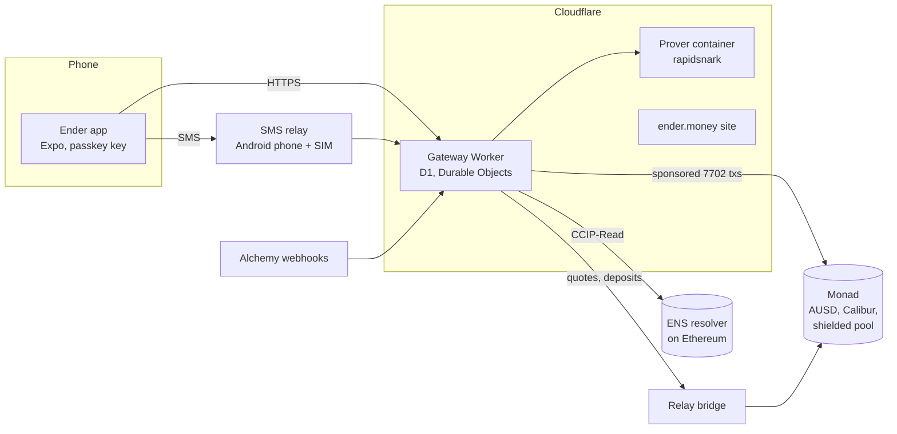

# Ender

A self-custodial dollar wallet on Monad that works over the internet or plain
SMS, with private payments.

Ender holds [AUSD](https://www.agora.finance/) on Monad. You sign up with a
passkey, get a name like `swift-otter-482.ender.my`, and pay anyone by name,
phone number or address. When the internet drops, the same payment goes out as
a text message. Incoming money moves into a private balance automatically, so
the chain doesn't show who paid whom.

- **Android app:** [assets.ender.money/android/ender.apk](https://assets.ender.money/android/ender.apk)
  (SHA-256 `ed72760ebac2d4fd54f1a95bad911758ec1c1a46dc6306c29fa8dd9f3958ad86`)
- **Web app:** [app.ender.money](https://app.ender.money) (same passkey as the
  Android app; payments by SMS are Android-only)
- **Website:** [ender.money](https://ender.money)
- **Example pay page:** [harsh.ender.my](https://harsh.ender.my)

## Try it

1. Install the APK on an Android phone (allow installs from your browser when
   asked).
2. Create a passkey. That's the whole sign-up: you get a random Ender ID and a
   wallet. No seed phrase, no phone number.
3. Settings → **Testnet mode** for play money (Monad testnet). Off means real
   AUSD on Monad mainnet.
4. Receive: share your Ender ID, the `ender1…` private address or the 0x
   address from the Receive screen. Send: Ender ID, phone number, `ender1…` or
   `0x…`.
5. Optional: Settings → **Phone number**. Verifying a number turns on the SMS
   features: payment alerts by text, sending with no internet, and being paid
   by number.

Testnet AUSD comes from Agora's faucet contract (`requestFunds(address)` at
`0xd236c18D274E54FAccC3dd9DDA4b27965a73ee6C` on Monad testnet), or ask us and
we'll send some.

## What it does

| | Mainnet | Testnet |
| --- | --- | --- |
| Public payments (internet or SMS) | ✓ | ✓ |
| Passkey accounts, gas sponsored, 0.01 AUSD fee | ✓ | ✓ |
| Ender IDs (`label.ender.my`, resolves in ENS wallets) | ✓ | ✓ |
| Payment alerts by SMS (Alchemy webhooks) | ✓ | ✓ |
| Private balance and private payments (Auto Shield) | ✓ (beta: 50 AUSD cap per deposit) | ✓ |
| Local-currency delivery (Agora pair, CTK) | — | ✓ |
| Auto-bridge: tokens sent to your address on Ethereum, Base, Arbitrum or Polygon arrive as AUSD (Relay) | ✓ | — |

**Internet first, SMS fallback.** Every payment is a signed message. Online it
goes to the gateway over HTTPS; offline the app texts it to the gateway's
number, and the gateway texts back the result. One GSM-7 segment each way.
Formats: [docs/SMS.md](docs/SMS.md).

**Self-custody.** The key comes from the passkey (WebAuthn PRF) and never
leaves the phone. The gateway can't move money without a fresh signature from
it; it only relays and pays the gas.

**Private payments.** A shielded pool with Groth16 proofs and a split key: the
phone holds the spending key, the gateway holds the viewing and nullifier keys
so it can build and prove transactions (proving takes 1–4 s in a container), but
every spend needs the phone's signature. Payments between Ender users show on
chain as pool transactions only. Design and trade-offs:
[docs/shielded-pool.md](docs/shielded-pool.md),
[docs/splitkey-spike.md](docs/splitkey-spike.md). On mainnet the pool is in
beta: each deposit (amount + fee) is capped at 50 AUSD (1000 on testnet), the
trusted setup has a single contributor, and nothing is audited.

## How it fits together



- **Accounts:** each user is an EOA delegated with EIP-7702 to Calibur, so the
  gateway can batch and sponsor its calls. Sign-in is a signature from the
  passkey-derived key.
- **Gateway:** a Cloudflare Worker with D1 for accounts, quotes and the pool
  index, and Durable Objects for the per-chain gas sponsor and the SMS relay.
  Scope and API: [docs/gateway.md](docs/gateway.md).
- **Ender IDs:** `ender.my` is a gasless DNS name in ENS. Lookups go through a
  CCIP-Read resolver whose answers the gateway signs.

## Tracks

- **Consumer payments:** a wallet for people who send money home and don't
  always have data: plain SMS, names instead of addresses, no seed phrase, no
  gas token.
- **Agora, cross-border payments:** AUSD end to end: payments by number or
  name across borders over SMS, and delivery in a local-currency token through
  the Agora pair (testnet).
- **Mera:** the passkey PRF is the whole key layer: one passkey prompt to sign
  up, Quick send sessions for repeat payments, Calibur with gas sponsorship.
- **Alchemy:** the gateway creates Address Activity webhooks on Monad mainnet
  and testnet (and Ethereum, Base, Arbitrum, Polygon for auto-bridge) and
  turns them into payment alerts and Activity, with no chain scanning.

## Contracts

| | Address |
| --- | --- |
| AUSD, Monad mainnet | `0x00000000eFE302BEAA2b3e6e1b18d08D69a9012a` |
| AUSD, Monad testnet | `0xa9012a055bd4e0eDfF8Ce09f960291C09D5322dC` |
| Calibur (EIP-7702 account, all chains) | `0x000000005c84F8Fd50b21CAC312528A64437030e` |
| Shielded pool, Monad mainnet (beta) | `0x1ff020082853ca376379e886cd46999490311579` |
| Shielded pool, Monad testnet | `0xbe34bb676ba6d40098e8aaa36b4599400c9810ff` |
| EnderResolver (CCIP-Read), Ethereum | `0xf0b537E1FDa87349d43E3aF991150aa6a0dCe01B` |

## Repo

```
app/       Expo app (Android; web build for previews)
gateway/   Cloudflare Worker: API, SMS commands, sponsor, pool index, names, bridge
protocol/  Shared TypeScript: SMS formats, Calibur batches, shielded notes, names
prover/    Groth16 prover container for the private pool
relay/     Android app that turns the gateway's SIM into an SMS relay
site/      ender.money landing page and waitlist
spikes/    Circuits, pool contracts and the experiments behind them
docs/      Design docs: gateway, SMS, shielded pool, runbooks, todo
```

Run it locally: `bun install`, then `bun run gateway:migrate:local`,
`bun run gateway:dev`, and in `app/`, `bunx expo start`. Tests:
`bun test ./gateway ./protocol ./app/src ./site`. Details in
[app/README.md](app/README.md) and [docs/gateway.md](docs/gateway.md).

## Status

Built for the Monad hackathon (October 2026). Public payments run on Monad
mainnet; the private pool runs on both, in beta on mainnet (50 AUSD per-deposit
cap, single-contributor trusted setup, unaudited) until a multi-party setup and an audit;
what's deferred is in [docs/todo.md](docs/todo.md).
